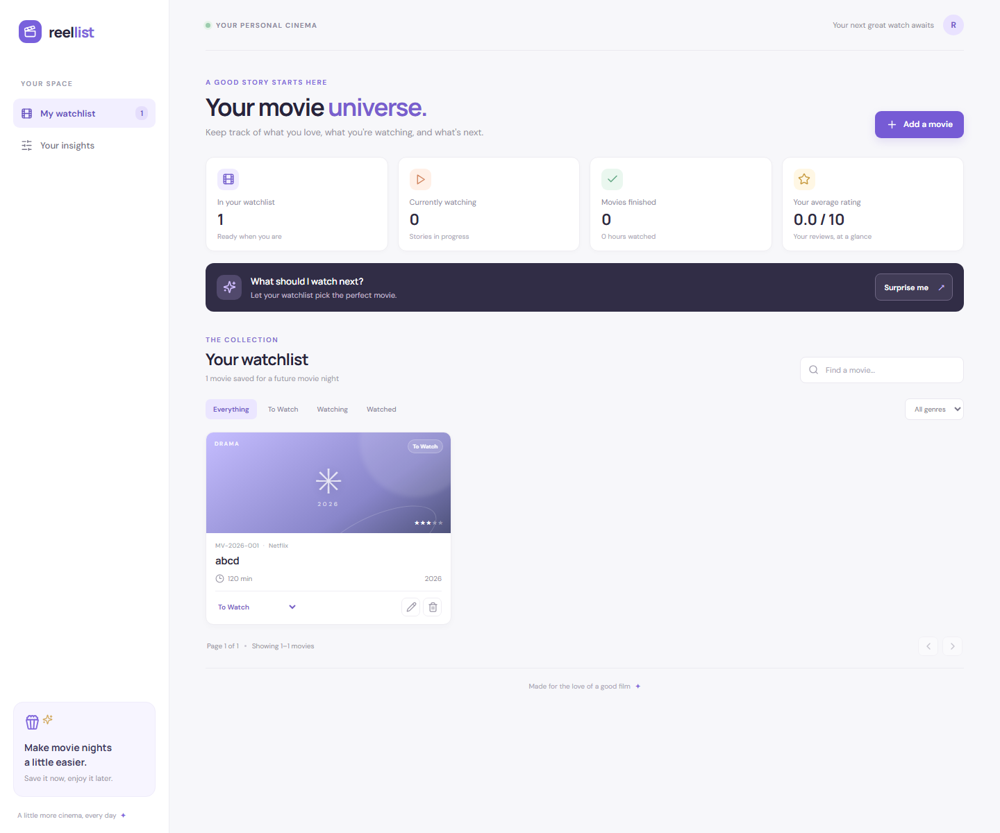
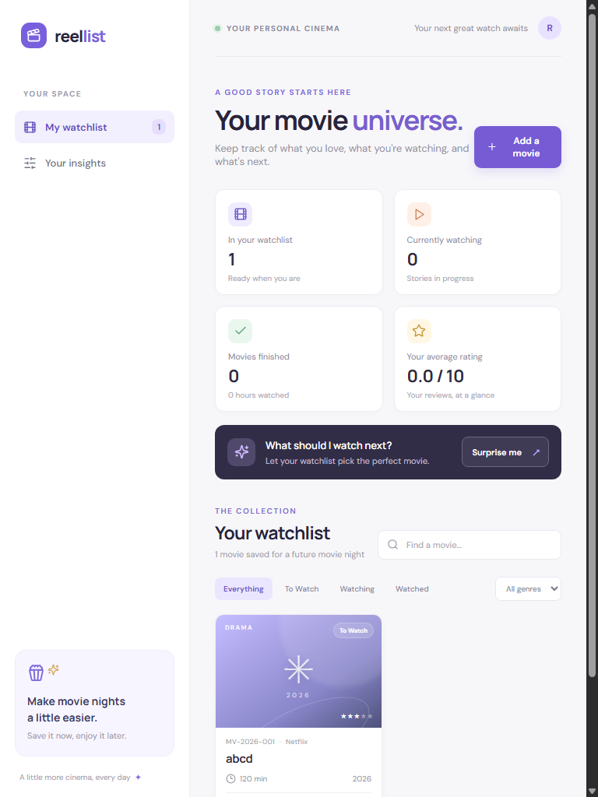

# ReelList — Movie Watchlist Manager

A responsive MERN app for saving movies, tracking viewing progress, rating finished films, and choosing what to watch next. The project is split into a Vite/React frontend and an Express/Mongoose backend.

## Requirements

- Node.js 18 or newer
- MongoDB running locally, or a test MongoDB Atlas database

## Setup

1. Install and start MongoDB. The committed `backend/.env` uses the local development URL `mongodb://127.0.0.1:27017/reellist`; change it to a test database URL if needed. It contains no account credentials.
2. In one terminal, install and start the API:

   ```sh
   cd backend
   npm install
   npm run dev
   ```

3. In another terminal, install and start the frontend:

   ```sh
   cd frontend
   npm install
   npm run dev
   ```

4. Open the Vite URL (normally `http://localhost:5173`). Vite proxies `/api` requests to the backend on port 5000.

`backend/.env` is a development configuration only. Replace `MONGODB_URI` with a test database URL when using Atlas; never commit personal or production credentials. `backend/.env.example` is also provided as a template.

## Deployment configuration

For local development, the frontend defaults to `/api/movies` and Vite proxies `/api` to `http://127.0.0.1:5000`. For a separately hosted frontend, set `VITE_API_BASE_URL` to the backend API URL ending in `/api/movies` before building the frontend (for example, `https://your-backend.example.com/api/movies`). Set the backend's `CLIENT_URL` to the hosted frontend's origin so CORS allows requests. A static frontend host does not run the Express API; deploy the backend separately.

## Screenshots

Screenshots of the running application are included below. The second image shows the responsive layout at a narrower viewport.





## API

All API responses use `{ "success": boolean, "message": string, "data": any }`.

| Method | Path | Purpose |
| --- | --- | --- |
| GET | `/api/health` | Check that the API is ready |
| GET | `/api/movies?page=1&status=To%20Watch&genre=Drama&search=matrix` | Search and filter the paginated movie list (6 per page) |
| GET | `/api/movies/stats` | Get status totals, watched hours, average rating, and top watched genre |
| GET | `/api/movies/next` | Choose the highest-priority To Watch movie, then the shortest runtime |
| POST | `/api/movies` | Add a movie; the server assigns its code |
| PATCH | `/api/movies/:id` | Edit allowed fields, change status, or update a Watched rating |
| DELETE | `/api/movies/:id` | Delete a movie unless it is currently Watching |

The API validates release year and runtime, enforces status transitions and rating rules, and uses MongoDB unique indexes for movie code and case-insensitive title/year uniqueness.

## Project structure

```text
Exam/
├── frontend/       # React and Vite application
├── backend/        # Express API and Mongoose models
├── screenshots/    # Application screenshots used above
└── README.md
```
